# Sanborn Stain Removal

Automatic color correction for scanned Sanborn fire insurance maps. The tool reduces broad yellow-brown discoloration, warm fringes near dark lines, and small residual brown spots. It estimates each page’s paper color and applies fixed image-processing rules.

The browser tool runs locally. Choose an image, select **Remove stains**, compare the original with the cleaned image, and download the full-resolution RGB PNG.

**San Francisco, 1899 · Sheet 6**

| Original | Cleaned |
| --- | --- |
|  | 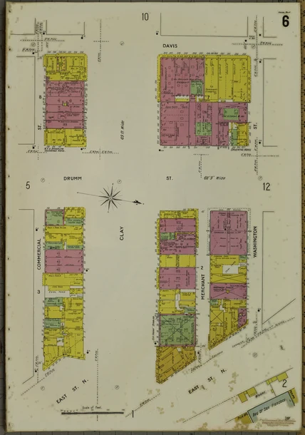 |

[See all map comparisons](#map-comparisons)

## Run the tool

Python 3.12 or newer is required. Download the repository using **Code → Download ZIP** and open a terminal in the extracted folder, or clone it with Git:

```sh
git clone https://github.com/JustinYbGao/sanborn-stain-removal.git
cd sanborn-stain-removal
```

Then create an environment, install the package, and start the tool.

macOS or Linux:

```sh
python3 -m venv .venv
source .venv/bin/activate
python -m pip install .
python -m sanborn_stain --serve
```

Windows PowerShell:

```powershell
py -m venv .venv
.\.venv\Scripts\python.exe -m pip install .
.\.venv\Scripts\python.exe -m sanborn_stain --serve
```

For the command-line and validation examples below, use `.\.venv\Scripts\python.exe` in place of `python` on Windows.

Open **http://127.0.0.1:8792/** in a browser. Keep the terminal running while using the tool. If the port is occupied, add `--port 8795` to the launch command and open that port instead. Press **Ctrl+C** in the terminal to stop the server.

The app accepts 8-bit RGB TIFF, JP2, PNG, or JPEG images up to 256 MiB and 80 million pixels. Processing takes place on your computer. The download retains the source raster dimensions. The page uses smaller previews for display.

The installation uses the exact NumPy, OpenCV, and Pillow versions validated against the reference output.

## Process an image from the command line

```sh
python -m sanborn_stain path/to/map.jp2 path/to/new-output-directory
```

Choose a new output directory for each run. It contains the cleaned PNG, pixel change and review masks, and metadata with source and output hashes.

A JP2 decoding error can indicate that the installed Pillow build lacks JPEG 2000 support. Check with:

```sh
python -m PIL
```

## How the method works

1. Estimate the paper color from bright, low-texture samples. Follow connected pixels of similar color to find supported paper.
2. Estimate broad shading and local discoloration, then apply bounded correction at the source resolution.
3. Compensate for yellow color left after brightening, using the estimated paper’s blue-to-green ratio.
4. Extend correction toward dark lines where nearby paper supports it and the original colors match.
5. Find compact dark, warm residuals surrounded by similar corrected paper. Blend a local correction away from dark ink.
6. Save a full-resolution RGB PNG.

The method was developed through inspection of map failures. The yellow correction followed residual yellowing on Sacramento. The line pass addressed fringes in San Francisco. The spot pass addressed isolated brown residues on San Francisco Sheet 6.

## Map comparisons

### San Francisco, 1899 · Sheet 6

Look for brown spots near the sheet number and the wharf. Dark staining remains along the bottom edge.

| Original | Current cleanup |
| --- | --- |
| 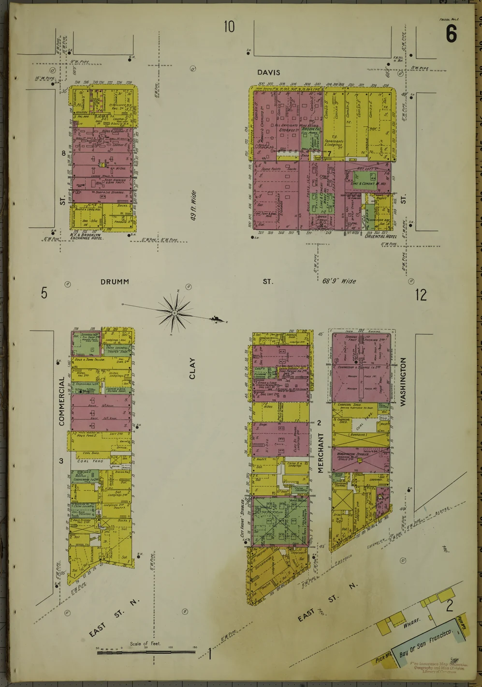 | 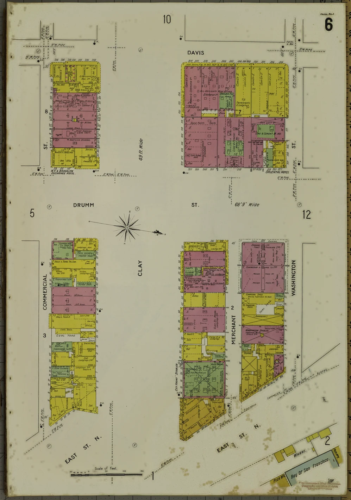 |

### Sacramento, 1895 · Sheet 10, left half

The broad yellow-brown cast across the street fades. Darker marks remain in several places.

| Original | Current cleanup |
| --- | --- |
| 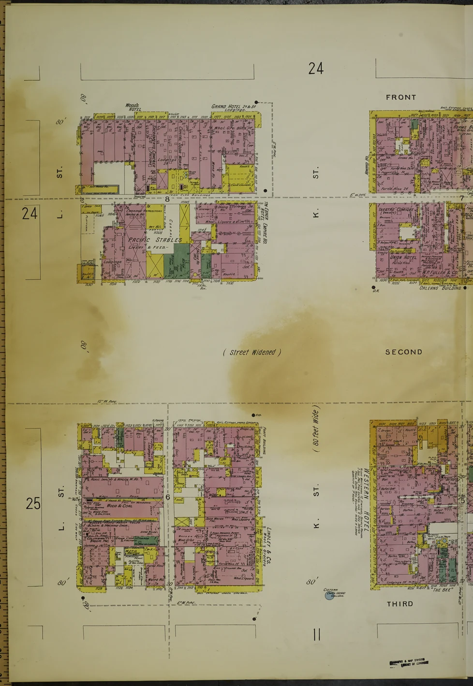 | 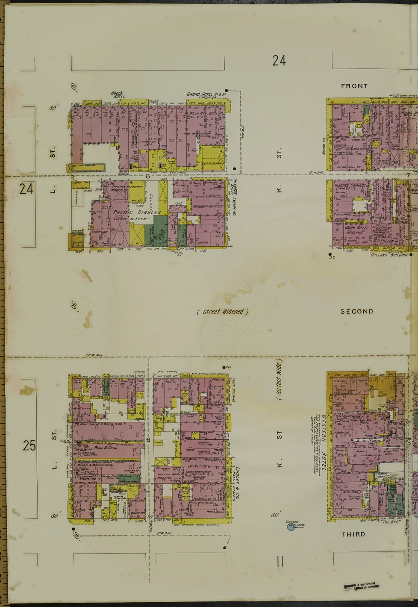 |

### San Francisco, 1899 · Sheet 7

The paper around the Palace Hotel is lighter, with less yellow along the diagonal ink lines.

| Original | Current cleanup |
| --- | --- |
| 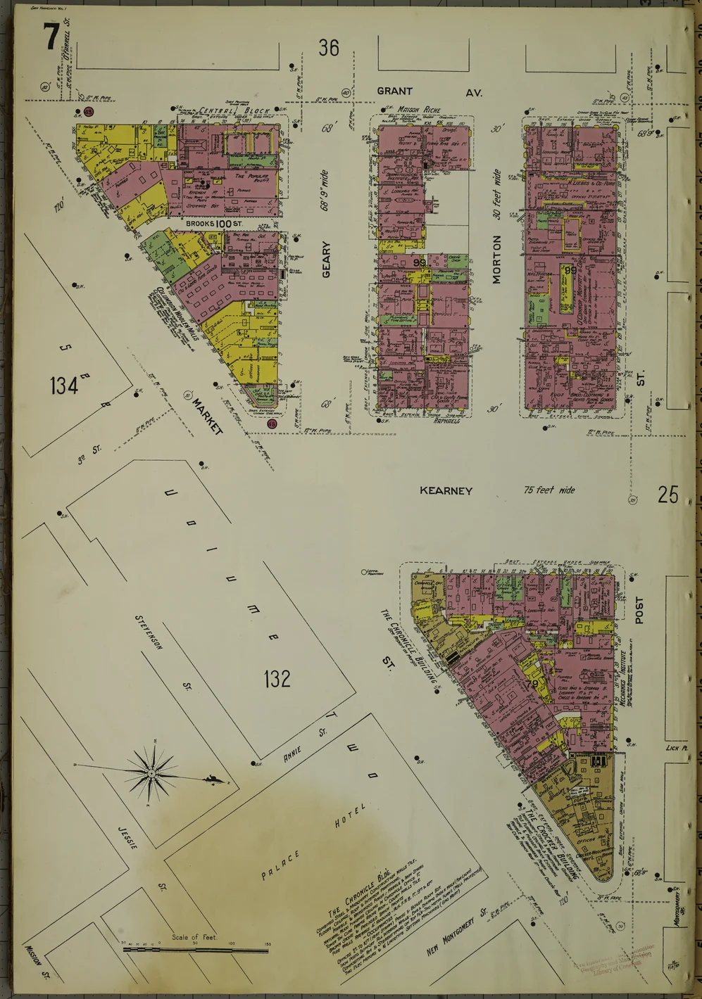 | 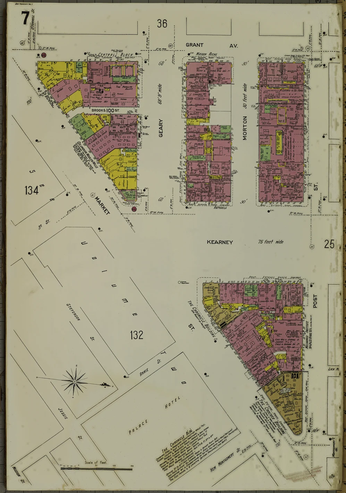 |

### San Francisco, 1899 · Sheet 4

The large brown stain across Fishermen’s Wharf becomes lighter. Some smaller marks remain visible.

| Original | Current cleanup |
| --- | --- |
| 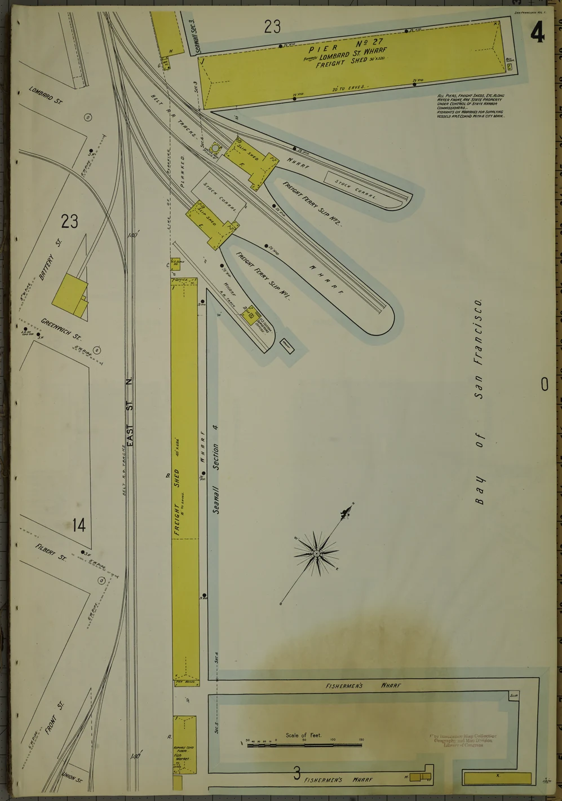 | 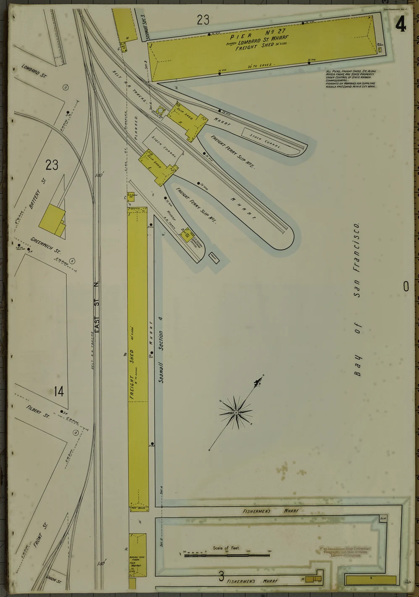 |

### Savannah, 1898 · Sheet 12

This scan shows the method’s limits. Several gray spots near the right edge remain visible after cleanup.

| Original | Current cleanup |
| --- | --- |
| 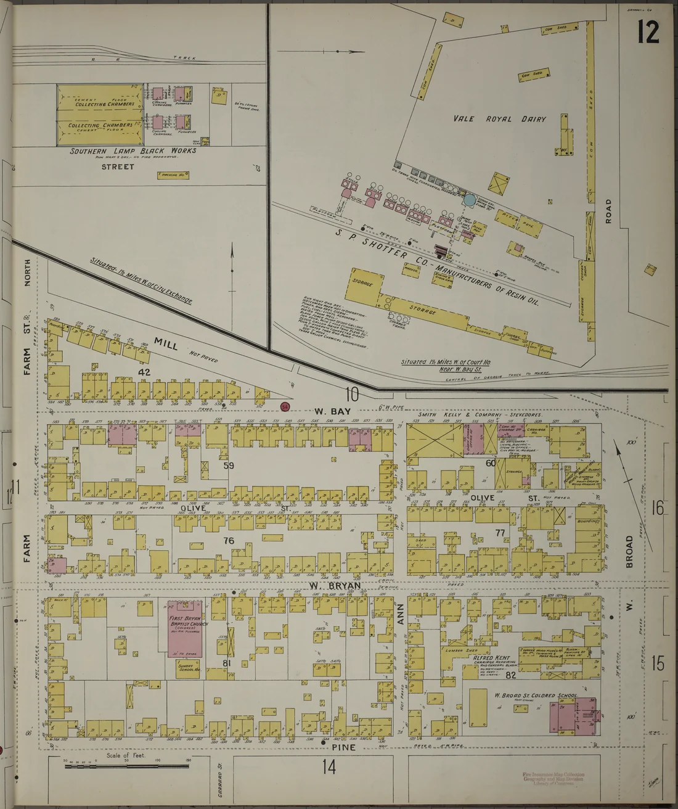 | 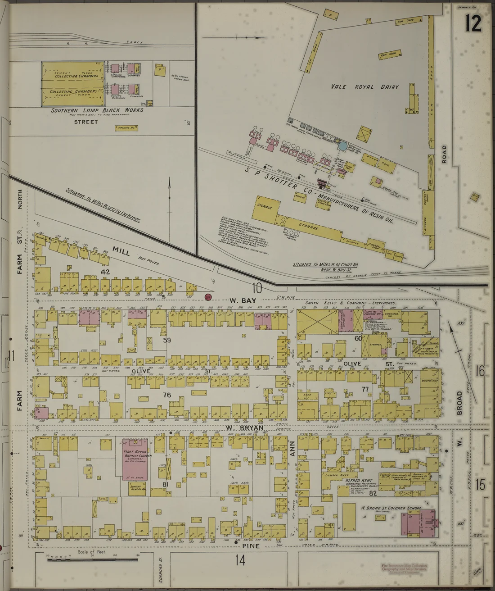 |

## San Francisco Sheet 6 details

These crops show what changed when spot correction was added. The left image in each pair shows the previous cleanup.

### Near the sheet number

Several isolated brown spots fade around the sheet number and the right margin.

| Before spot correction | Current cleanup |
| --- | --- |
|  | 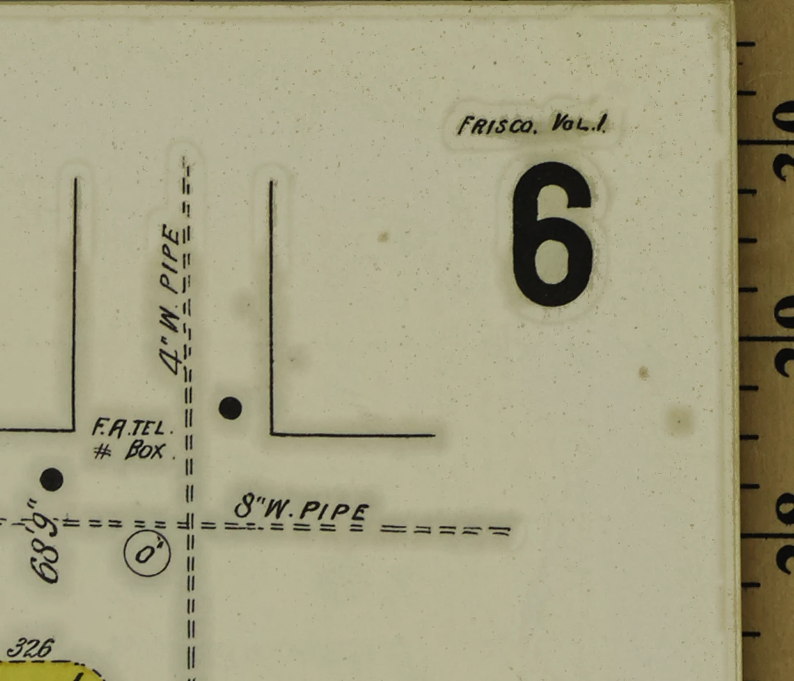 |

### Near the wharf

Some isolated spots fade. Dark clusters along the binding edge remain.

| Before spot correction | Current cleanup |
| --- | --- |
| 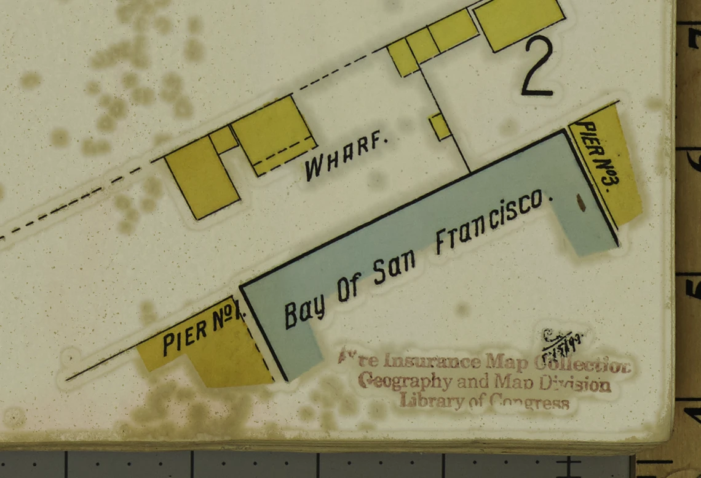 | 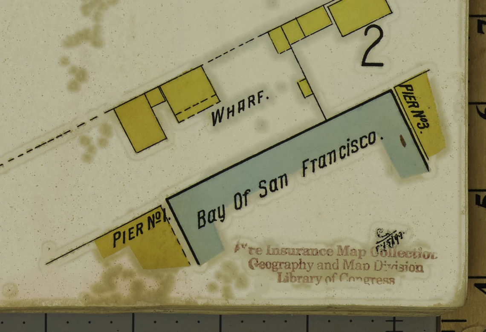 |

## Evidence and current limits

Development records include 37 distinct successfully processed scans across earlier versions. The spot-correction experiment covered nine scans.

On 12 selected San Francisco Sheet 6 development locations, 10 spots decreased in contrast by at least 2 CIE76 color-distance units. Twenty-four sampled print footprints on five other sheets retained their original RGB values. These are targeted checks with selected regions and approximate paper references.

Dense stains near bindings, deep marks, some gray spots, and discoloration touching ink can remain. Pale printed areas close to the paper color require review. Downstream building-detection improvements have not been established for the current version.

## Validation

```sh
python -m unittest discover -s tests -v
```

The packaged method is derived from the local experimental implementation. [Provenance](PROVENANCE.json) records the source hashes and packaging changes.

## Map sources

The development scans are from the Library of Congress, Geography and Map Division, Sanborn Maps Collection.

The coworker’s [building labeling project](https://github.com/Arshgsgsy/building_segment) supplies the separate candidate-generation and labeling workflow. The cleaned RGB output can be passed to a later map-processing stage.
